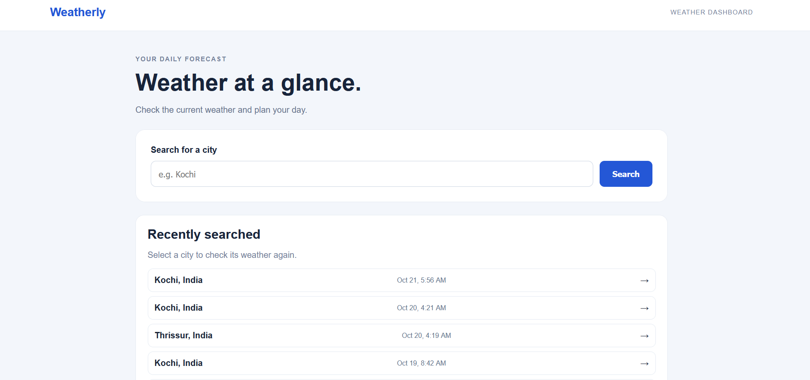
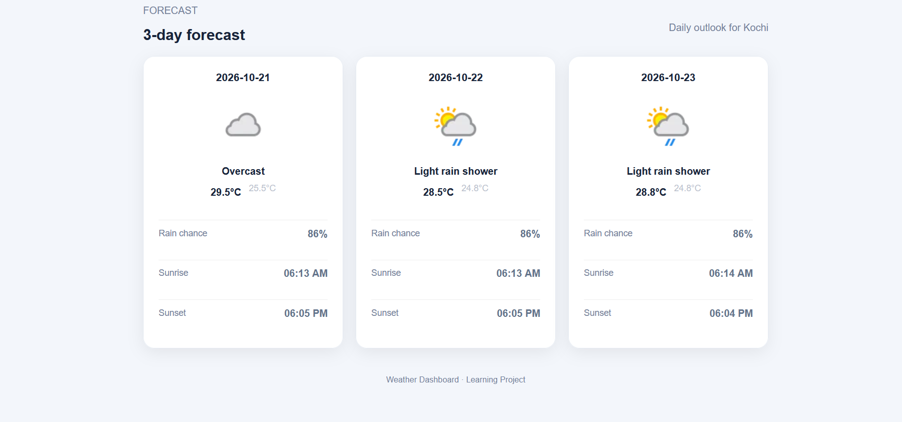

# 🌦️ Weather Dashboard

A Django-based weather dashboard that retrieves real-time weather data and displays a three-day forecast for searched cities. The application combines a clean, responsive interface with API integration, database-backed search history, and automated testing.

**Built with Python, Django, SQLite, HTML, CSS, JavaScript, and WeatherAPI.com.**

[View Source Code](https://github.com/AustinKuruvilla/weather-dashboard)

---

## 📌 Project Overview

The Weather Dashboard allows users to search for a city and view its current weather conditions and upcoming forecast. It also stores recent searches so users can quickly revisit previously searched cities.

This project demonstrates practical skills in backend development, REST API consumption, database integration, frontend development, error handling, and software testing.

## ✨ Features

- **Current Weather:** Displays current temperature, weather conditions, and relevant weather statistics.
- **Three-Day Forecast:** Presents forecast information for the next three days.
- **City Search:** Retrieves weather information using a city name.
- **Recent Search History:** Stores recent city searches in an SQLite database and provides quick access to previously searched cities.
- **Error Handling:** Displays a helpful message when weather data cannot be retrieved for a city.
- **Responsive UI:** Provides a styled interface with weather cards and forecast sections.
- **Automated Testing:** Includes a Django test suite to verify application behavior.
- **Environment-Based Configuration:** Keeps the WeatherAPI key in a local environment file rather than application source code.

## 🛠️ Technology Stack

| Technology | Purpose |
|---|---|
| Python | Application logic |
| Django | Web framework and request handling |
| SQLite | Persistent recent-search history |
| HTML5 | Page structure |
| CSS3 | Styling and responsive layout |
| JavaScript | Search interaction and loading feedback |
| WeatherAPI.com | Current weather and forecast data |
| Django Test Framework | Automated testing |
| Git and GitHub | Version control and source-code hosting |

## 🖥️ Application Preview

### Dashboard



### Three-Day Forecast



### Recent Searches


### Error Handling


Recommended screenshots:

1. Main dashboard with current weather.
2. Three-day forecast.
3. Recent searches.
4. Invalid-city error message.

## 📂 Project Structure

```text
weather-dashboard/
├── config/
│   ├── __init__.py
│   ├── settings.py
│   ├── urls.py
│   ├── asgi.py
│   └── wsgi.py
├── weather/
│   ├── migrations/
│   ├── static/
│   │   └── weather/
│   │       ├── app.js
│   │       └── style.css
│   ├── templates/
│   │   └── weather/
│   │       └── index.html
│   ├── admin.py
│   ├── apps.py
│   ├── models.py
│   ├── tests.py
│   ├── urls.py
│   └── views.py
├── .gitignore
├── manage.py
├── requirements.txt
└── README.md
```

## ⚙️ Installation and Setup

### Prerequisites

- Python 3 installed
- pip package manager
- A WeatherAPI.com API key

### 1. Clone the repository

```bash
git clone https://github.com/AustinKuruvilla/weather-dashboard.git
cd weather-dashboard
```

### 2. Create and activate a virtual environment

**Windows PowerShell:**

```powershell
python -m venv .venv
.\.venv\Scripts\Activate.ps1
```

If PowerShell blocks activation, use this alternative for the current terminal session:

```powershell
.\.venv\Scripts\python.exe -m pip install -r requirements.txt
```

### 3. Install dependencies

```powershell
python -m pip install -r requirements.txt
```

### 4. Configure the WeatherAPI key

Create a `.env` file in the same directory as `manage.py`:

```dotenv
WEATHERAPI_KEY=your_weatherapi_key_here
```

Get an API key from [WeatherAPI.com](https://www.weatherapi.com/) and replace the placeholder with your key.

**Security note:** Never commit `.env` or expose your API key in screenshots, source code, or public documentation.

### 5. Set up the database

```powershell
python manage.py migrate
```

### 6. Run the application

```powershell
python manage.py runserver
```

Open the application in your browser:

[http://127.0.0.1:8000/](http://127.0.0.1:8000/)

## 🧪 Testing

Run the automated Django test suite:

```powershell
python manage.py test
```

**Verified local test result**

- Tests discovered: 7
- Tests passed: 7
- Failures: 0
- Django system checks: No issues identified

These results reflect the local test run during project development.

## 🔐 Configuration and Security

- API credentials are loaded from a local `.env` file.
- `.gitignore` excludes `.env`, `.venv/`, and `db.sqlite3`.
- Database migrations are included in the repository.
- API keys should be configured separately in any deployment environment.

## 🚀 Future Enhancements

- Deploy the application and provide a public demo.
- Add screenshots and a short demonstration GIF.
- Improve handling of API timeouts, rate limits, and network failures.
- Expand automated test coverage for additional edge cases.
- Add a continuous integration workflow using GitHub Actions.
- Add weather search suggestions and more detailed forecast information.

## 🎯 Skills Demonstrated

This project provides practical evidence of:

- Python and Django web development
- API integration and JSON response handling
- Database models and migrations
- Form input validation and error handling
- Frontend development with HTML, CSS, and JavaScript
- Automated testing and debugging
- Git version control and GitHub project management
- Environment-variable configuration

## 👨‍💻 Author

**Austin Kuruvilla M**

GitHub: [AustinKuruvilla](https://github.com/AustinKuruvilla)

---

*This project was developed as a portfolio project to demonstrate practical web development and testing skills.*

